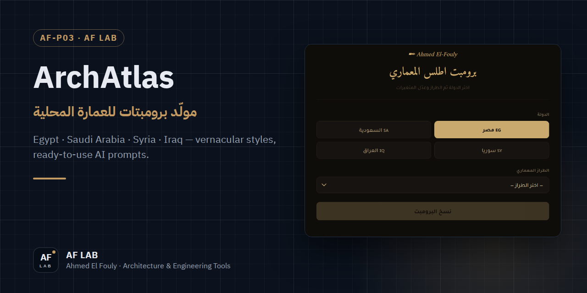
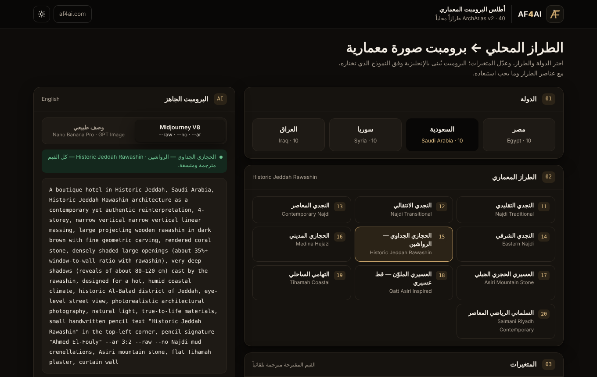

<p align="center">
  
</p>

<h1 align="center">ArchAtlas</h1>

<p align="center">
  <b>مولّد برومبتات للعمارة المحلية في مصر والسعودية وسوريا والعراق</b><br>
  An interactive prompt generator for vernacular architecture across four countries.
</p>

<p align="center">
  <a href="https://af-lab.archprompt.workers.dev"></a>
  <a href="https://engfouly1987.github.io/ArchAtlas/"></a>
  
  
</p>

<p align="center">
  <a href="https://engfouly1987.github.io/ArchAtlas/"><b>فتح الأداة · Open the tool ↗</b></a> &nbsp;·&nbsp;
  <a href="https://af-lab.archprompt.workers.dev">AF LAB</a> &nbsp;·&nbsp;
  <a href="https://wa.me/201284537045">WhatsApp</a>
</p>

---

## نظرة سريعة · Overview

<div dir="rtl">

**ArchAtlas** أداة ويب للمعماريين والمصممين ومستخدمي الذكاء الاصطناعي. اختار الدولة والطراز المعماري، عدّل المتغيرات، وخد برومبت جاهز لأدوات توليد الصور. كل طراز مبني على هوية إقليمية حقيقية: الثقافة، والمناخ، والخامات، والمنطق الفراغي.

</div>

An architect-friendly tool: pick a country and a vernacular style, tune the variables, and copy a ready-to-use prompt for image generators. Each style reflects regional identity, climate response, material authenticity and spatial logic.

<p align="center">
  
</p>

## الدول والطُرز · Regions & styles

| الدولة · Country | أمثلة على الطُرز · Example styles |
|---|---|
| 🇪🇬 مصر · Egypt | فرعوني، مملوكي، قبطي، نوبي · Pharaonic, Mamluk, Coptic, Nubian |
| 🇸🇦 السعودية · Saudi Arabia | نجدي، حجازي، عسيري، تهامي · Najdi, Hejazi, Asiri, Tihamah |
| 🇸🇾 سوريا · Syria | دمشقي، حلبي، أموي · Damascene, Aleppine, Umayyad |
| 🇮🇶 العراق · Iraq | عباسي، بغدادي، بلاد الرافدين · Abbasid, Baghdadi, Mesopotamian |

## المزايا · Features

- 🎯 **برومبتات جاهزة للذكاء الاصطناعي** · AI-ready prompts, optimized for image-generation tools
- 🏗️ **دقة معمارية** · grounded in real architectural styles
- ⚙️ **نظام متغيرات** (خامات، نِسَب، مناخ…) · custom variables: materials, proportions, climate
- 📋 **نسخ بنقرة واحدة** · one-click copy
- 🌍 **أربع دول** وأكتر بالتدريج · four countries, more to come

## الاستخدامات · Use cases

- توليد صور معمارية (Midjourney, DALL·E, Stable Diffusion) · AI image generation
- استكشاف مفاهيم التصميم · architectural concept exploration
- دراسات الهوية الثقافية في العمارة · cultural design studies
- هندسة البرومبت للعمارة · prompt engineering for architecture

## تشغيل محلي · Run locally

```bash
git clone https://github.com/engfouly1987/ArchAtlas.git
cd ArchAtlas
# افتح index.html في المتصفح · open index.html in your browser
```

مفيش تثبيت ولا خادم. ملف واحد يشتغل مباشرة. · No install, no server: it runs straight from the file.

## المساهمة · Contributing

<div dir="rtl">

أي اقتراح أو تحسين مرحّب بيه: افتح Issue أو اعمل Fork و Pull Request.

</div>

## الترخيص · License

MIT

## التواصل · Contact

<div dir="rtl">

للاستفسار أو طلب أداة أو تعديل، أسرع طريقة **واتساب**. وباقي القنوات تحت.

</div>

| | |
|---|---|
| 💬 WhatsApp | [+20 128 453 7045](https://wa.me/201284537045) |
| ✉️ Email | [ahmedfouly08@gmail.com](mailto:ahmedfouly08@gmail.com) |
| 🌐 AF LAB | [af-lab.archprompt.workers.dev](https://af-lab.archprompt.workers.dev) |
| Facebook | [ahmed.fooly](https://www.facebook.com/ahmed.fooly) |
| Instagram | [@ah.elfouly](https://www.instagram.com/ah.elfouly/) |
| GitHub | [engfouly1987](https://github.com/engfouly1987) |

---

<p align="center">
  <sub>جزء من <a href="https://af-lab.archprompt.workers.dev"><b>AF LAB</b></a> — أدوات ومؤلفات وتطبيقات ويب للمهندسين والمعماريين.<br>
  Part of <a href="https://af-lab.archprompt.workers.dev"><b>AF LAB</b></a> — tools, books and web apps for engineers and architects.</sub>
</p>
